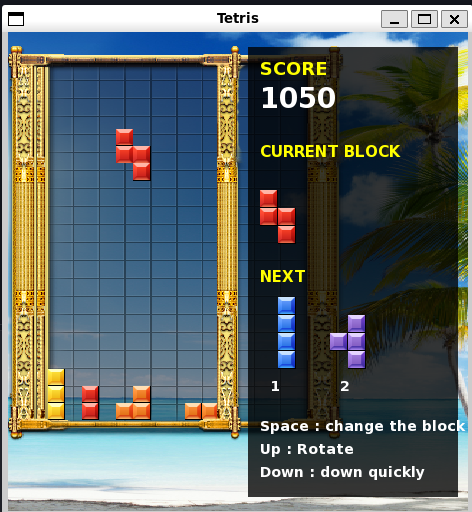

# Tetris SFML (C++ OOP)

A classic Tetris game written in C++ with [SFML](https://www.sfml-dev.org/),
structured with object-oriented design (`Tetromino`, `Board`, `Game`).



## Features

- 7 tetromino shapes with random colors
- Line clearing with score bonuses (100 / 300 / 500 / 800)
- Score panel showing the **current block** and the **next 2 blocks**
- Press **Space** to swap the falling block with the next one
- Custom background and golden frame
- Automatic restart on game over

## Controls

| Key | Action |
|-----|--------|
| Left / Right | Move block |
| Up | Rotate |
| Down | Fast drop |
| Space | Swap with next block |

## Project Structure

```
tetris/
├── main.cpp
├── images/
│   ├── tiles.png
│   ├── background.png
│   └── frame.png
├── docs/
│   └── image.png
├── .gitignore
└── README.md
```

## OOP Design

| Class | Responsibility |
|-------|----------------|
| `Tetromino` | Stores the shape, color and cell positions of one block; `move()` and `rotate()` |
| `Board` | Holds the 10x20 grid (private); collision check, locking blocks, clearing lines |
| `Game` | Input handling, score, block queue, update loop and rendering |

## Requirements

- g++ with C++11 or newer
- SFML 2.x

On Ubuntu / WSL:

```bash
sudo apt update
sudo apt install g++ libsfml-dev fonts-dejavu-core
```

## Build and Run

Run from the project root so the `images/` path resolves correctly:

```bash
g++ main.cpp -o main -lsfml-graphics -lsfml-window -lsfml-system
./main
```

> On WSL, a GUI window requires WSLg (Windows 11 or recent Windows 10).

## Credits

Built as a learning project in C++ and SFML. Tile, background and frame
graphics are from the SFML Tetris tutorial assets; please check their
licenses before redistributing.